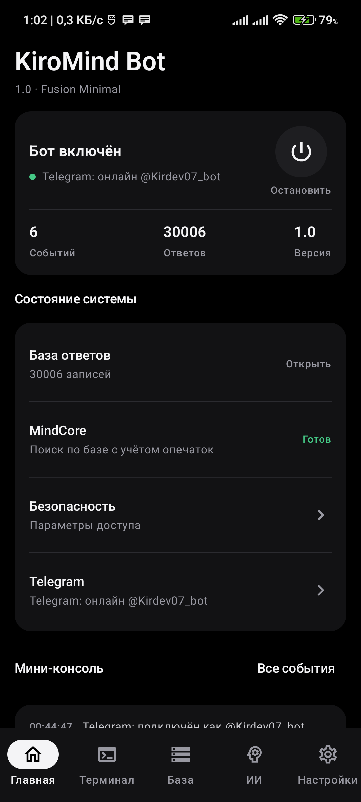
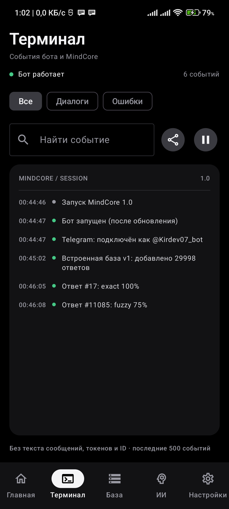
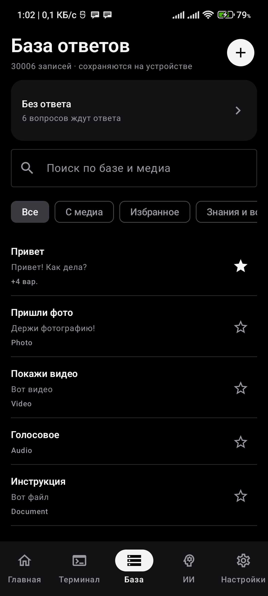
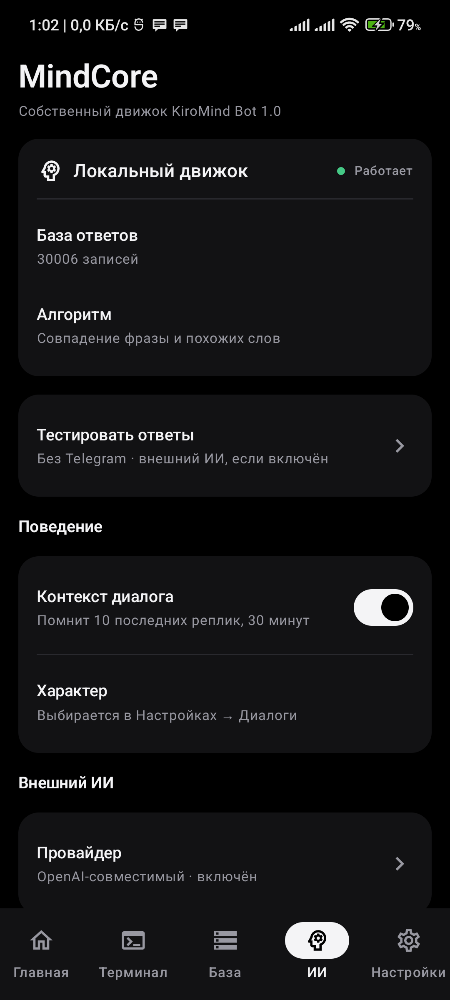
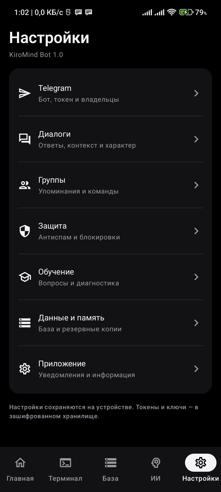

# KiroMind Bot

Telegram-бот, который работает прямо на Android-телефоне. Отвечает по своей базе с помощью собственного движка **MindCore**: понимает опечатки и разные формулировки, помнит контекст разговора и говорит в выбранном характере. Если ответа в базе нет, может спросить внешний ИИ.

Автор — **Kirdev**. Лицензия — Apache 2.0.

  
  
  
  
  

## Возможности

- **MindCore.** Ищет похожий вопрос, а не точное совпадение: «приветт», «слушай, а как дела, бот?» и «чё как» поймёт правильно. Помнит последние реплики, поэтому может продолжить диалог.
- **Встроенная база на 30 000 вопросов.** 106 тем: приветствия, настроение, болтовня, шутки и факты, советы по фильмам, книгам и играм, рассказ о себе и о разработчике. Ставится при первом запуске и не трогает ваши собственные ответы.
- **Характеры.** Обычный, дружелюбный, вежливый, дерзкий (может материться) и «Авто», который чередует первые три.
- **Своя база ответов.** Несколько вариантов на один вопрос, фото, видео, голосовые и файлы, продолжения диалога, категории и исключения.
- **«Без ответа».** Вопросы, на которые бот не нашёл ответа, собираются в список, их можно сразу научить. Владелец может учить и прямо из Telegram: `/teach вопрос = ответ`.
- **Внешний ИИ.** Gemini, Claude, YandexGPT или OpenAI-совместимый сервис (Groq, OpenRouter и др.), с дневным лимитом и лимитом в минуту.
- **Защита.** Антиспам, автоблокировка, чёрный список, команды владельца `/block`, `/unblock`, `/blocked`, `/stop`.
- **Группы.** Бот отвечает на упоминание, ответ на своё сообщение или обращение вида «Бот, …».
- **Данные.** Экспорт и импорт базы (`.kmbackup.json`), автоматические резервные копии, журнал событий с экспортом.
- **Самообновление.** Приложение само находит новый релиз на GitHub, сверяет подпись и SHA-256 и предлагает установить.

## Установка

1. Скачайте последний `KiroMind-Bot-x.y.z.apk` в разделе [Releases](https://github.com/kirdev07/KiroMind-Bot__Kirdev.07/releases).
2. Установите APK и разрешите установку из этого источника, если Android спросит.
3. Дальнейшие обновления приложение предложит само (Настройки → Приложение → Обновления).

Нужен **Android 10 или новее**. Проверено на Android 12.

## Первый запуск

1. Создайте бота у [@BotFather](https://t.me/BotFather) и скопируйте токен.
2. В приложении: **Настройки → Telegram**. Вставьте токен и укажите свой Telegram ID в поле «ID владельцев через запятую».
3. Нажмите кнопку питания на главном экране. Бот работает, пока он включён: в шторке будет уведомление.
4. Напишите боту в Telegram. Ответы можно проверить и без Telegram: **ИИ → Тестировать ответы**.

На телефонах Xiaomi (MIUI) разрешите приложению автозапуск и работу в фоне. Иначе система может остановить бота.

## Безопасность

- Токен Telegram и ключи ИИ хранятся в зашифрованном хранилище Android (Keystore). Если расшифровать не получилось, бот просто не запускается: ключ никогда не сохраняется открытым текстом.
- В журнал не попадают тексты сообщений, токены и ID. В резервные копии не входят токены и ключи.
- Текст вопроса уходит внешнему ИИ, только если вы сами его включили.

## Для разработчиков

- [docs/ARCHITECTURE.md](docs/ARCHITECTURE.md) — устройство проекта и MindCore.
- [docs/RELEASING.md](docs/RELEASING.md) — как выпускаются и подписываются релизы.
- [tools/basegen](tools/basegen) — исходник встроенной базы (`topics.txt`) и генератор.
- [THIRD_PARTY_NOTICES.md](THIRD_PARTY_NOTICES.md) — лицензии библиотек.

Kotlin, Jetpack Compose, Room, DataStore, Telegram Bot API.

## Лицензия

Apache License 2.0, см. [LICENSE](LICENSE) и [NOTICE](NOTICE).
